<p align="center">
  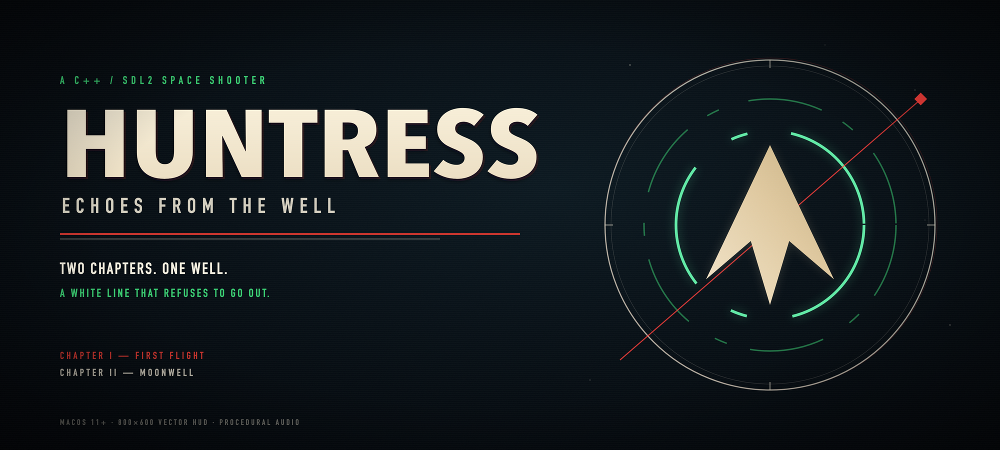
</p>

<h1 align="center">HUNTRESS: ECHOES FROM THE WELL</h1>

<p align="center">
  <b>A 2D vector space shooter about a white line that refuses to go out.</b><br>
  <sub>C++11 · SDL2 · 800×600 · procedural audio · cut-corner smoked-glass HUD</sub>
</p>

<p align="center">
  <a href="https://github.com/Lezheng2333/Spaceshooter-game--Huntress-Echoes-from-the-Well/releases/tag/v1.2.29">
    
  </a>
  
  
  
</p>

---

## At a Glance

| | |
|---|---|
| **Genre** | 2D / 2.5D vector space shooter |
| **Chapters** | I — FIRST FLIGHT · II — DEEP SPACE / MOONWELL |
| **Platform** | macOS 11.0+ (native `.app`; rebuild from source for another architecture) |
| **Rendering** | SDL2 primitives, wireframe ships, CRT scanlines, cut-corner glass HUD |
| **Audio** | 100% procedural — synth BGM + synthesized SFX + bilingual voice-over |
| **Save system** | pause-save / load the exact frame / AUTO + SLOT 1–6 / free file browser |
| **Latest** | **v1.2.29** — new app icon, visual README, release pipeline |

---

## Screenshots / 游戏实际截图

<table>
  <tr>
    <td width="50%">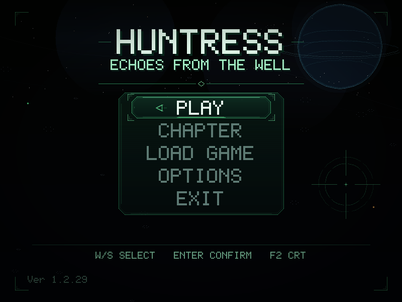<br><sub><b>Start screen</b> · cut-corner smoked-glass HUD / 开始页</sub></td>
    <td width="50%">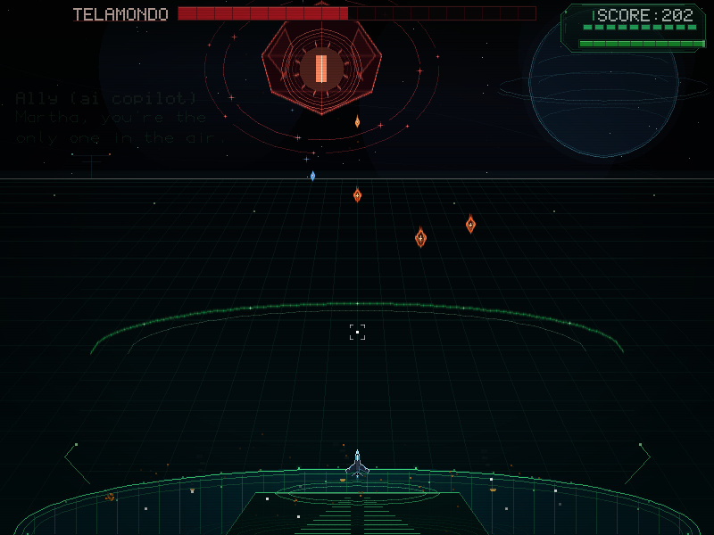<br><sub><b>Chapter I / TELAMONDO</b> · the green life base under siege / 第一章 Boss</sub></td>
  </tr>
  <tr>
    <td width="50%">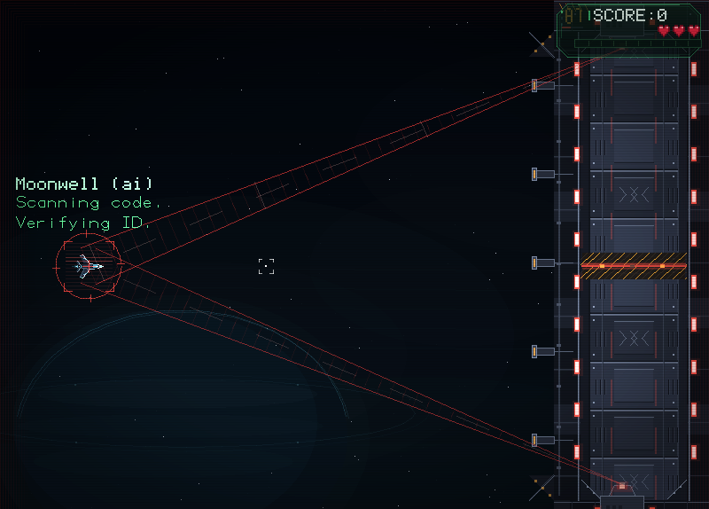<br><sub><b>Moonwell gate</b> · red scan sequence / 月井真空门扫描</sub></td>
    <td width="50%">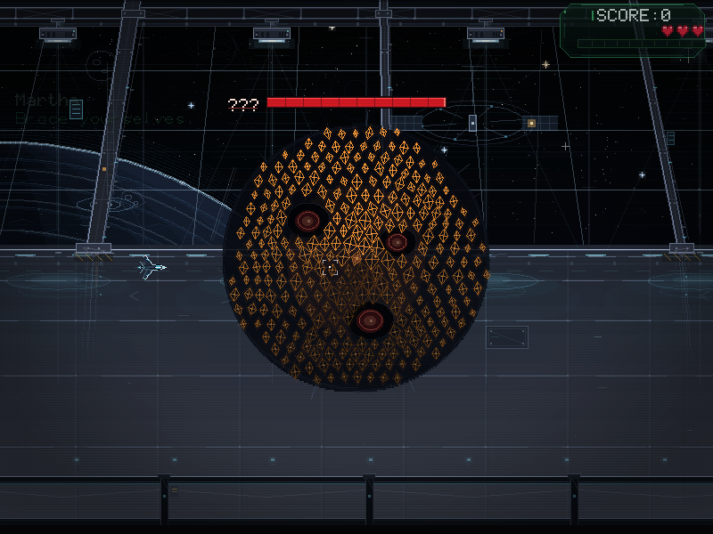<br><sub><b>PROLIFERATRIX</b> · the diamond sphere / 万殖之母球体</sub></td>
  </tr>
  <tr>
    <td width="50%">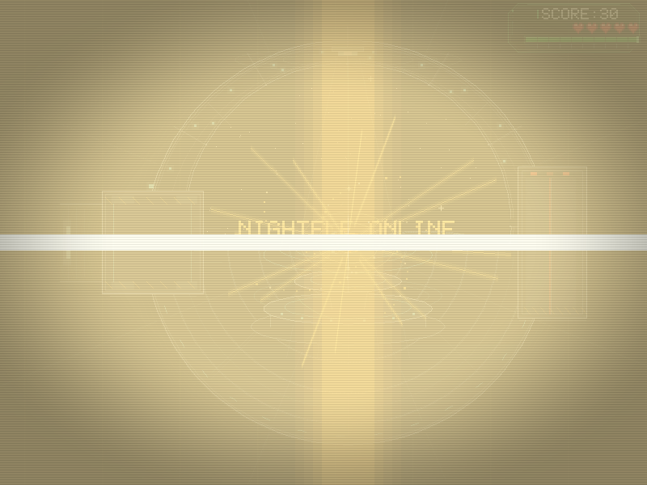<br><sub><b>NIGHTELF ACQUIRED</b> · gold-flash handover / 换机金色爆闪</sub></td>
    <td width="50%">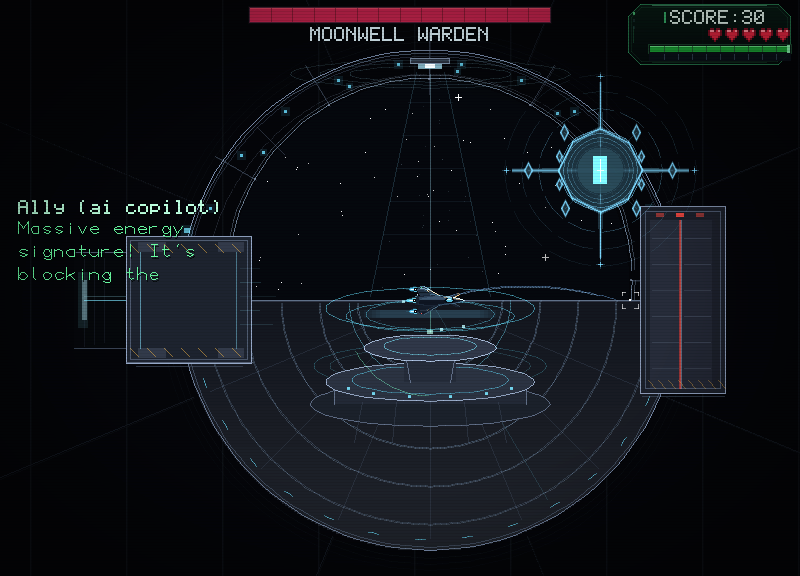<br><sub><b>MOONWELL WARDEN</b> · the round lab / 章节 Boss</sub></td>
  </tr>
</table>

> All shots are real in-game frames, captured through the game's own `--selftest` render path (headless, no screen recording).

---

## Posters & Key Art / 海报与主视觉

### Constructivist chapter posters — drawn from scratch in HTML/SVG

<table>
  <tr>
    <td width="50%">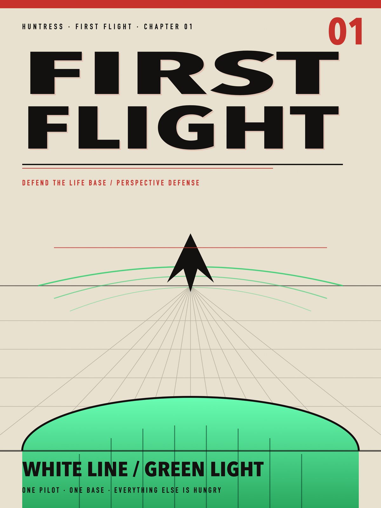<br><sub><b>I — FIRST FLIGHT</b><br>green life base · perspective grid · white line</sub></td>
    <td width="50%">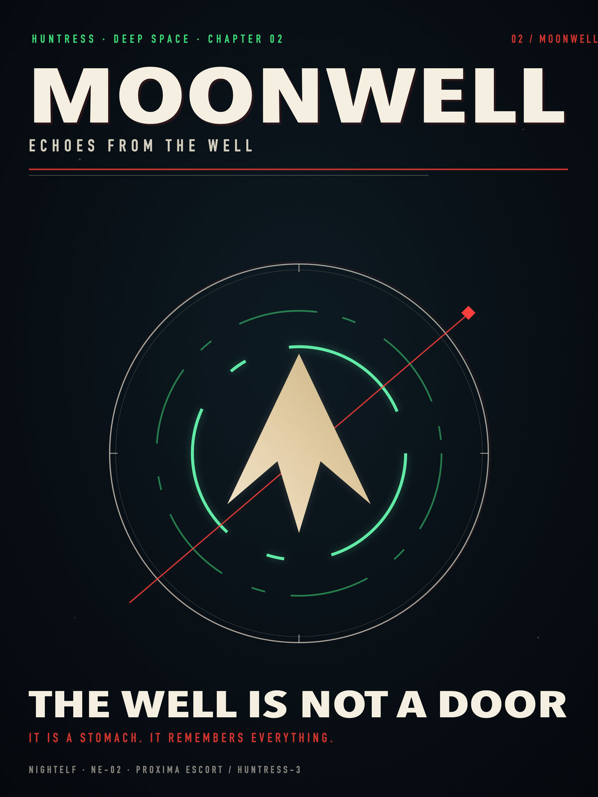<br><sub><b>II — MOONWELL</b><br>echo array · red scan · champagne-gold mark</sub></td>
  </tr>
</table>

### Pixel-art ship posters

<table>
  <tr>
    <td width="50%">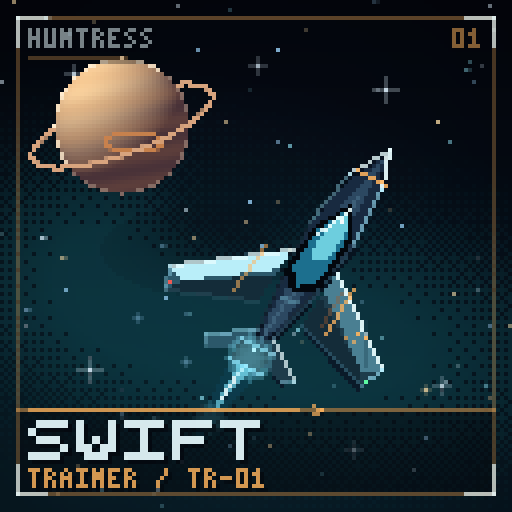<br><sub><b>SWIFT / TR-01</b> · trainer · single engine · V-tail</sub></td>
    <td width="50%">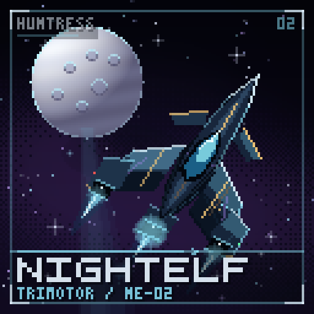<br><sub><b>NIGHTELF / NE-02</b> · trimotor · gold canards · cyan canopy</sub></td>
  </tr>
</table>

---

## The App Icon / macOS 图标

**v1.2.29** ships with a new hand-drawn app icon: **02 “ECHO ARRAY”**.

- One solid champagne-gold mark; no cockpit, no interior lines.
- Two strings only: **HUNTRESS** / **ECHOES FROM THE WELL**.
- 1024×1024 canvas · 824×824 content · 185.4 px corner radius · 10 `.icns` representations.
- The outline also reads as a three-toed beast track — a quiet echo of **Huntress**.

<table>
  <tr>
    <td width="62%">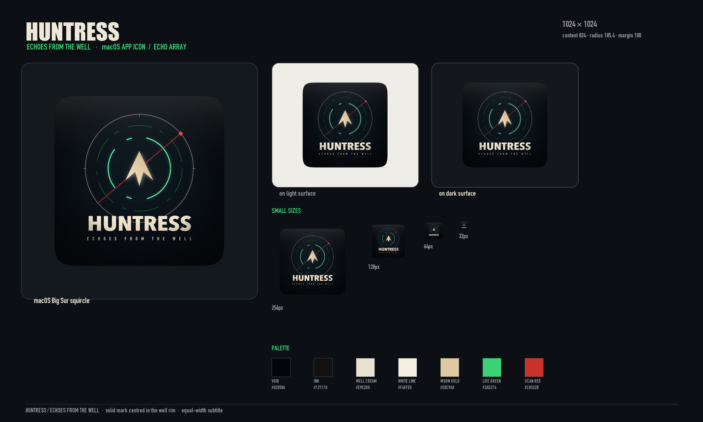</td>
    <td width="38%">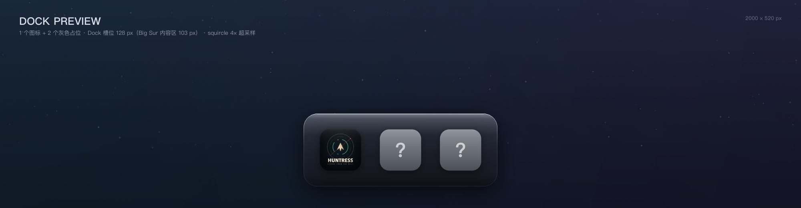</td>
  </tr>
</table>

- Icon file: [`art/icon/huntress/Huntress.icns`](art/icon/huntress/Huntress.icns)
- Editable source: [`art/icon/huntress/huntress_icon.html`](art/icon/huntress/huntress_icon.html)
- Preview set: [`art/icon/huntress/preview/`](art/icon/huntress/preview/)

---

## What's New / 最近更新 — v1.2.29

### Release & presentation

- **New macOS app icon** — “ECHO ARRAY”: champagne-gold mark, deep-space echo rings, red scan chord, only the two game-name strings.
- **Release pipeline now owns the icon** — `release.sh` copies `Huntress.icns` into `Contents/Resources/`, writes `CFBundleIconFile`, verifies the `.icns`, then signs.
- **README visual overhaul** — real screenshots, two constructivist chapter posters, upscaled pixel ship posters, icon board + Dock preview.
- **In-game screenshot capture** — `--selftest` now also exports a Chapter I combat frame for README/QA (`/tmp/sfss_readme_shots/`).

### v1.2.29 gameplay & art

- **NightElf handover rebuilt** — gold particles converge → full-screen flash → radial beams/column/sparks → `NIGHTELF ACQUIRED`; the actual swap happens on the brightest frame, never a hard cut.
- **New NightElf fanfare + SFX** — C# major 16-step procedural fanfare; dedicated charge/flash/complete cues.
- **NightElf is now 5 HP**, trainer stays at 3; HUD hearts adapt per ship; Pulse heal cap follows the current hull.
- **Warden max HP 350 → 500**; enrage threshold 175 → 250. Bullet patterns, damage and flow unchanged.
- **Trainer “Swift” finalized** — one plan-view silhouette for both perspective and side-scroll chapters; **TrainerUpgrade / Gryphon** kept as a dormant asset.
- **Capsule hitboxes** — hull mid-section capsule (trainer 8/9/4, NightElf 12/22/5); wingtips, long nose and exhaust no longer take hits.
- **Asset Studio 0.2.4** — 107 registered assets, NightElf / Swift / Gryphon / Dryad / Druid-Wraithlight entries, hitbox overlay, command palette, frame timeline, real waveform, pinned compare.
- **Compatibility** — no new save fields; `SAVE_FORMAT_VERSION` unchanged. `SAVE_GAME_VERSION` now `10229` (display only).

---

## Play / Controls

| Key / 按键 | Action / 操作 |
|---|---|
| **W A S D** | Move / 移动 |
| **Space / 空格** | Shoot / 射击 |
| **Shift** | Pulse shockwave (after absorbing a skill orb) / 脉冲冲击波 |
| **Esc** | Pause / 暂停 |
| **F2** | CRT scanline overlay on/off / CRT 扫描线开关 |

**Save system / 存档** — pause at any moment, `SAVE GAME`; next launch choose `LOAD GAME` and resume on the exact frame you saved (including bullets in flight). `AUTO` + `SLOT 1–6` + free file browser. See the in-game pause menu for the full menu map.

---

## Download / 下载

> macOS 11.0+ · native build (rebuild from source for another architecture)

**[Download v1.2.29](https://github.com/Lezheng2333/Spaceshooter-game--Huntress-Echoes-from-the-Well/releases/tag/v1.2.29) — latest**

Download the `.zip`, unzip, and run `Huntress: Echoes from the Well ver1.2.29.app`.

下载 `.zip` 后解压，直接运行 `Huntress: Echoes from the Well ver1.2.29.app`。

<details>
<summary>Previous releases</summary>

- [v1.2.28](https://github.com/Lezheng2333/Spaceshooter-game--Huntress-Echoes-from-the-Well/releases/tag/v1.2.28)
- [v1.2.27](https://github.com/Lezheng2333/Spaceshooter-game--Huntress-Echoes-from-the-Well/releases/tag/v1.2.27)
- [v1.2.26](https://github.com/Lezheng2333/Spaceshooter-game--Huntress-Echoes-from-the-Well/releases/tag/v1.2.26)
- [v1.2.25](https://github.com/Lezheng2333/Spaceshooter-game--Huntress-Echoes-from-the-Well/releases/tag/v1.2.25)
- [v1.2.24](https://github.com/Lezheng2333/Spaceshooter-game--Huntress-Echoes-from-the-Well/releases/tag/v1.2.24)
- [v1.2.23](https://github.com/Lezheng2333/Spaceshooter-game--Huntress-Echoes-from-the-Well/releases/tag/v1.2.23)
- [v1.2.21](https://github.com/Lezheng2333/Spaceshooter-game--Huntress-Echoes-from-the-Well/releases/tag/v1.2.21)
- [v1.2.20](https://github.com/Lezheng2333/Spaceshooter-game--Huntress-Echoes-from-the-Well/releases/tag/v1.2.20)

</details>

---

## Build from Source / 从源码编译

macOS prerequisites: Xcode Command Line Tools, SDL2, Python 3.

```bash
xcode-select --install
brew install sdl2

cd "v2.0.0/multiple code files" && make
```

Manual compile:

```bash
cd "v2.0.0/multiple code files" && clang++ -std=c++11 \
  -I/opt/homebrew/include -I/opt/homebrew/include/SDL2 \
  -D_THREAD_SAFE main.cpp -o shooter -L/opt/homebrew/lib -lSDL2
```

Developer commands:

```bash
./shooter              # normal play / 正常游玩
./shooter --test       # hidden TEST menu / 隐藏测试入口
./shooter --selftest   # save-system + flow QA, 0 = PASS / 自检
./shooter --mknodes    # regenerate 34 node saves / 节点存档
```

---

## Asset Studio / 素材工坊 v0.2.4

The game's art is code, not image files. Asset Studio calls the real drawing functions so previews never drift from the game.

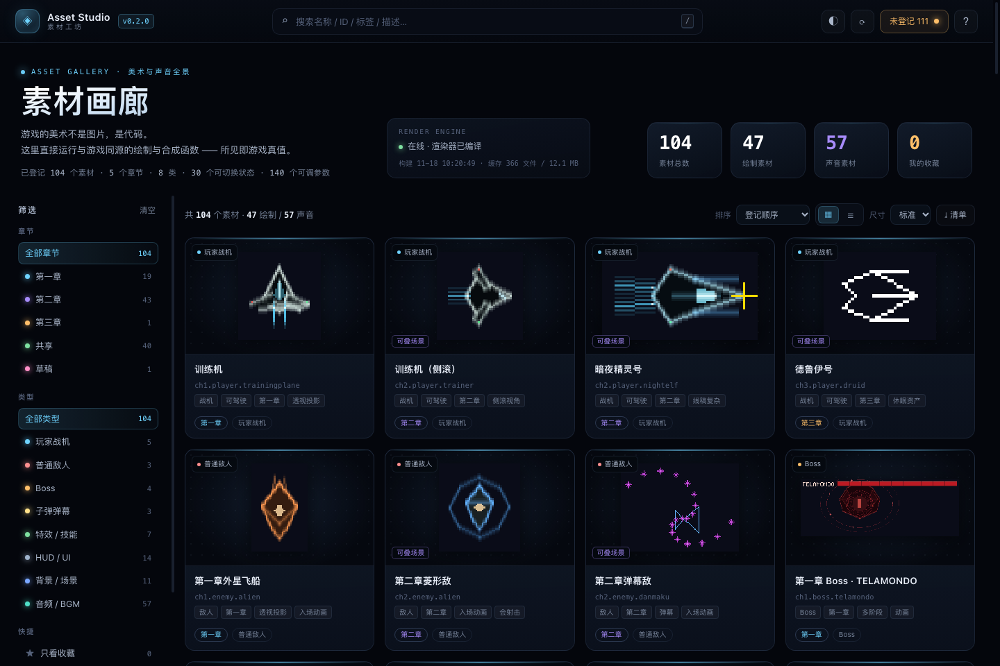

```bash
bash tools/asset_studio/studio.sh          # compile + serve + open browser
# http://127.0.0.1:8791/
```

```bash
cd tools/asset_studio
./assetstudio --verify-all                 # all art assets × states
./audiopreview --verify-all                # BGM + SFX export check
python3 registry/scanner.py                # registry completeness
make server                                # server only
```

Features: command palette (⌘K), favorites/recent, frame timeline, real waveform, pinned compare, deep links, part relationships, cache manager, keyboard shortcuts, headless UI smoke tests.

---

## QA / Engineering

- `--selftest`: **PASS** — save round-trips, menu wiring, Ch2 seven-stage flow, gate/airlock, sphere drops/ghost/shatter, NightElf 5 HP + gold swap + skill card, Warden 500 HP, capsule hitboxes.
- `make -Wall -Wextra`: zero warnings.
- Icon pipeline: `art/icon/huntress/_pipeline/` — Edge headless render → Big Sur squircle mask → `iconutil` `.icns`; 10 representations verified.
- README art pipeline: `art/readme/` — real frames captured through the game's offscreen renderer; posters/hero drawn in HTML/SVG.
- No new save fields in v1.2.29; `SAVE_FORMAT_VERSION` unchanged.

---

## Project Structure

```
├── README.md
├── DEVELOPMENT_LOG.md
├── CLAUDE.md
├── art/
│   ├── icon/huntress/          # v1.2.29 app icon + Editable HTML + .icns + preview
│   ├── posters/                # pixel ship posters
│   └── readme/                 # README hero, chapter posters, real screenshots
├── v1.0.0/                     # historical archive
└── v2.0.0/                     # current mainline (v1.2.29)
    ├── multiple code files/    # C++ source (34 headers + main.cpp)
    │   ├── main.cpp  game.h
    │   ├── save_system.h  save_menu.h
    │   ├── ship_art.h  player.h  audio.h
    │   ├── ch1/  ch2/
    │   └── ...
    ├── space_shooting ver1.2.20 single-file archive.cpp
    └── Release Version/
        ├── historical .app / .zip
        └── Huntress: Echoes from the Well ver1.2.29.app + .zip
```

---

## License

MIT. Code, procedural art, BGM and SFX are authored in this repository. No third-party image assets are bundled with the game; fonts used by the README art pipeline are system macOS fonts, rasterized only into preview images.
