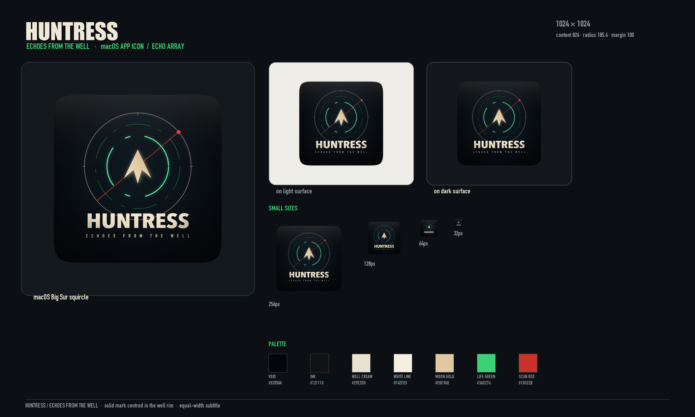

# HUNTRESS — ECHOES FROM THE WELL
## macOS App Icon · 02「回声阵列 / ECHO ARRAY」最终版



> 最终方向：02 回声阵列。
> 图标内只有两个字符串：**HUNTRESS** / **ECHOES FROM THE WELL**。
> 中央飞机在原轮廓基础上去掉座舱与所有内部线条，成为**一整块香槟金色块**；
> 在 09 小号基础上再缩小 10%，三枚尾尖、左右翼短于中轴尾——远看是抽象战机，也像一枚神秘动物的三趾爪印，与 **Huntress**（猎手/足迹）呼应。

---

## 1. 本轮调整（按你的反馈）

- **飞机更窄**：整体宽度从 52 → 42（局部坐标）；基于 09 小号再缩小 10%（scale 4.65 → 4.185）。
- **尾部三个尖尖更窄更尖**：左右两翼收窄；中轴尾尖更长更尖；三个尾点之间切口更深。
- **左右翼比中间尾短**：翼 42 / 中轴尾 50，左右翼比中轴短一截。
- **中央下移**：形体基准点 cy 302 → 332，使形体的视觉包围盒中心对齐井沿中心 436，不再偏上。
- **标题上移**：HUNTRESS 基线上移到 812，压住井沿下缘圆环，标题更醒目。
- **字号放大**：HUNTRESS 112 → 124；副标题 24 → 28，并用 `textLength=630` 让副标题与主标题**同宽**。
- **换主色**：中央色块改为**香槟金渐变**（`#F3E6CB → #E0C9A0 → #C6AE7E`），与游戏的冷白/绿主色稍微拉开；标题保留奶油白。
- **光影/质感**：中央色块加左上高光渐变 + 右下投影 + 柔金外晕；标题加克制的投影/渐变；底场保留细扫描线、纸墨颗粒、暗角与套印偏移。
- 仍然是实心色块：没有座舱、没有中线、没有内部细节、没有描边。

---

## 2. 元素

| 元素 | 处理 |
|---|---|
| 深空底 | `#02050A`，径向提亮 + 细尘埃 + CRT 扫描线 + 纸墨颗粒 + 暗角 |
| 井沿 | 奶油色细圆环 + 红色套印偏移 + 四向刻度 |
| 回声 | 两条绿色脉冲弧（一强一弱），绿色只作生命/信号重音 |
| 扫描 | 一条细红扫描弦，端点一枚红菱形；对应真空门扫描/锁定 |
| 中央 | 香槟金实心抽象舰形：无座舱、无内部线；窄、三尾尖、左右翼短于中轴；视觉中心对齐井沿中心 |
| 字标 | HUNTRESS：Avenir Next Condensed Heavy 124；ECHOES FROM THE WELL：DIN Condensed Bold 28，`textLength=630` 与主标题同宽；两行即全部文字 |
| 光影 | 色块左上高光、右下投影、柔金外晕；标题与副标题细投影；全图轻微暗角 |

### 色板

| 名称 | HEX | 用途 |
|---|---|---|
| VOID | `#02050A` | 深空底 |
| INK | `#121110` | 印刷墨黑 |
| WELL CREAM | `#E9E2D0` | 井沿/辅助 |
| WHITE LINE | `#F4EFE0` | 标题/副标题 |
| MOON GOLD | `#E0C9A0` | 中央色块（渐变中段） |
| LIFE GREEN | `#3AD274` | 生命/回声脉冲 |
| SCAN RED | `#C8322B` | 扫描弦/菱形/套印 |

> 无五角星、无俄语、无镰刀锤子、无 CCCP、无政治标语。构成主义只作为形式语法使用。

---

## 3. macOS 规格

| 项 | 值 |
|---|---|
| 画布 | 1024 × 1024 |
| 内容区 | 824 × 824，居中，四边 100 |
| 圆角 | 185.4（Big Sur 规范） |
| 格式 | `Huntress.icns`，10 个 rep（16/32/64/128/256/512/1024；512@2x 用 1024 源图） |
| 已检查 | 1024 / 512 / 256 / 128 / 64 / 32；浅色/深色表面；仿 Dock 128 槽位 |

---

## 4. 文件

```
art/icon/huntress/
├── README.md                         本文件
├── huntress_icon.html                可编辑源文件
├── huntress_icon_1024.png            1024 方形原稿
├── Huntress.icns                     macOS 图标
├── Huntress.ico                      Windows 图标（7 个尺寸）
├── preview/
│   ├── Huntress_presentation.png     设计板
│   ├── Huntress_mac_1024.png         macOS squircle
│   ├── Huntress_mac_{512,256,128,64,32}.png
│   ├── Huntress_raw_1024.png
│   └── Huntress_dock.png
├── _pipeline/                        渲染/预览/打包脚本
└── _research/00_brief.md             项目剧情/视觉研究简报
```

重新渲染 / 打包：
```bash
cd art/icon/huntress
_pipeline/render.sh huntress_icon.html huntress_icon_1024.png 1024 1
/Users/song_jiarui/.dsh/dsh-runtimes/dsh-primary-runtime/dependencies/python/bin/python3 \
  _pipeline/mac_preview.py huntress_icon_1024.png _pipeline/huntress_icon_mac.png --shape squircle --inner
_pipeline/make_icns.sh _pipeline/huntress_icon_mac.png Huntress.icns
```

---

## 5. 装进 macOS App（下一步，尚未对 .app 执行）

```bash
APP="v2.0.0/Release Version/Huntress: Echoes from the Well ver1.2.28.app"
cp art/icon/huntress/Huntress.icns "$APP/Contents/Resources/Huntress.icns"
/usr/libexec/PlistBuddy -c "Add :CFBundleIconFile string Huntress" "$APP/Contents/Info.plist" 2>/dev/null \
  || /usr/libexec/PlistBuddy -c "Set :CFBundleIconFile Huntress" "$APP/Contents/Info.plist"
codesign --force --deep --sign - "$APP"
touch "$APP"
```

---

## 6. 清理记录

- 其余 4 个方向、10 个中央形体变体已删除；旧 `planet_icon_*` 等旧图标资产已清理。
- 当前 `art/icon/` 下只剩 `huntress/`。
